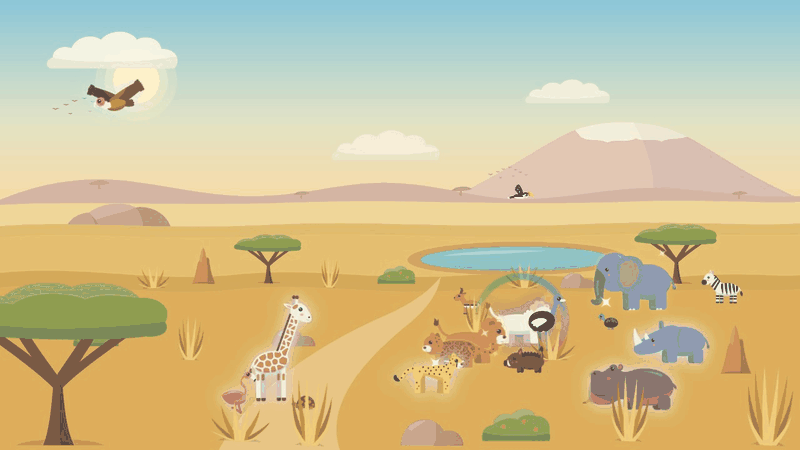
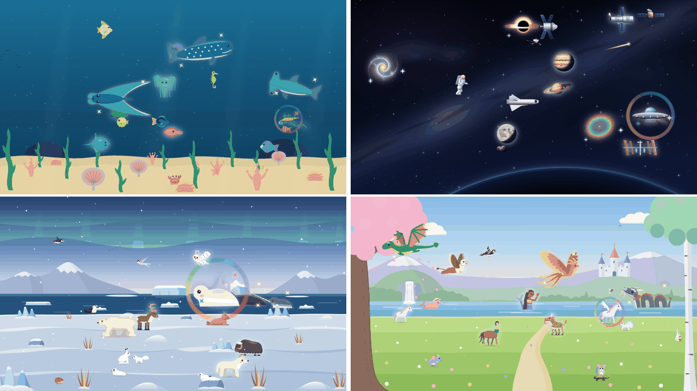
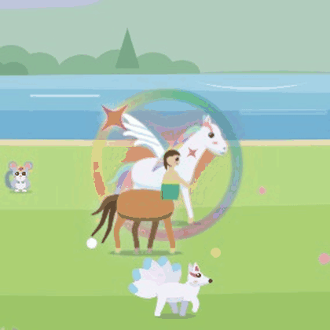
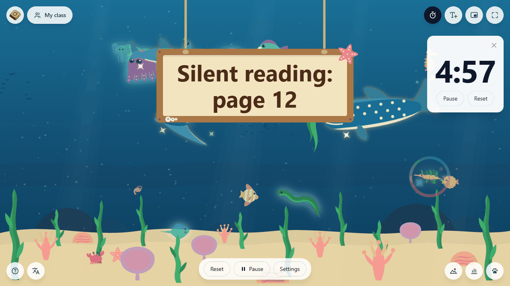
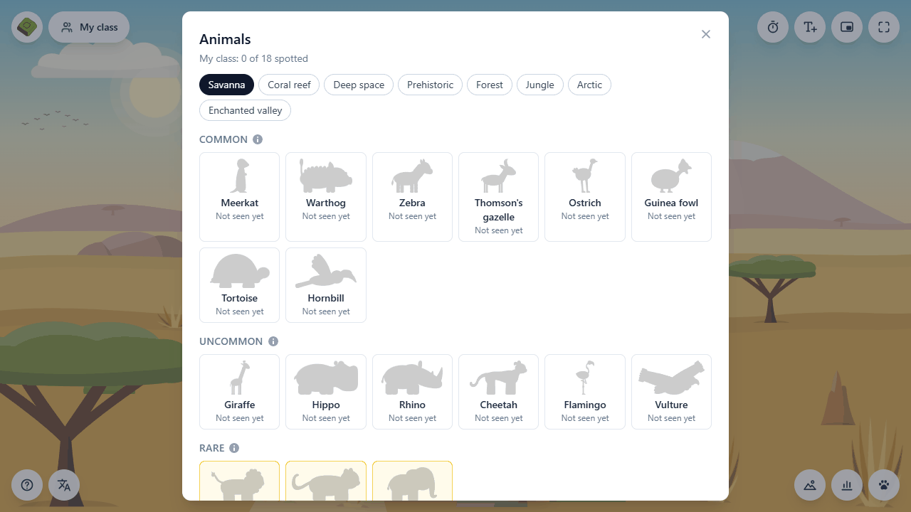
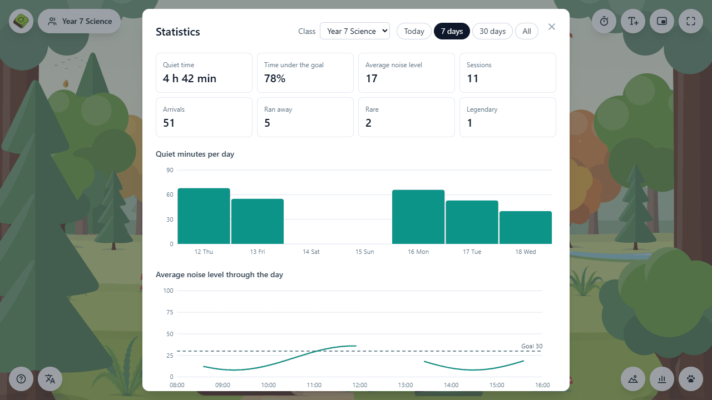
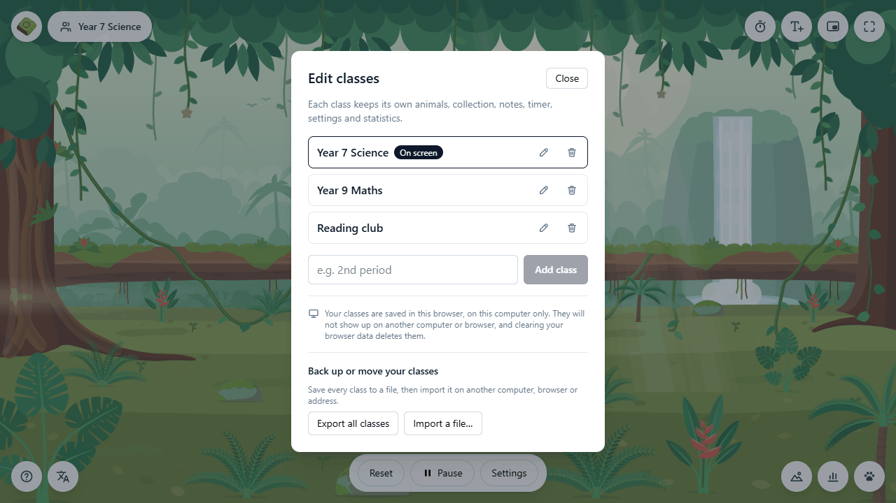
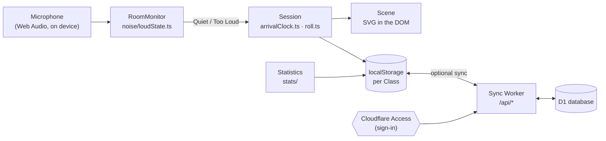

<a name="readme-top"></a>

<div align="center">


# Shy Safari

_A classroom noise monitor that rewards quiet. Shout, and the animals hide._

[Install](#install) • [Usage](#usage) • [How it works](#how-it-works) • [Live site](https://www.shysafari.com) • [Changelog](CHANGELOG.md) • [Français](docs/fr/README.md)

[![Typecheck][badge-typecheck]][ci-typecheck]
[![Tests][badge-tests]][ci-tests]
[![Lint][badge-lint]][ci-lint]
[![Build][badge-build]][ci-build]

[![Version][badge-version]](CHANGELOG.md)
[![License][badge-license]](LICENSE.txt)
[![Last commit][badge-commit]][commits]



</div>

---

- [0. 🚦 Status](#status)
- [1. ✨ What it does](#what-it-does)
- [2. 📖 Background](#background)
- [3. 🧰 Tech stack](#tech-stack)
- [4. 🚀 Install](#install)
- [5. 🎮 Usage](#usage)
- [6. ⚙️ How it works](#how-it-works)
- [7. 🗓️ Version history](#version-history)
- [8. 🙏 Credits & license](#credits)

## <a name="status"></a>0. 🚦 Status

| Check                            | State                                                                 |
| -------------------------------- | --------------------------------------------------------------------- |
| Typecheck · Tests · Lint · Build | see the badges above (GitHub Actions, one workflow each)              |
| Latest version                   | **[v1.0.0](CHANGELOG.md#100--2026-11-17)** — 2026-11-17               |
| Live                             | [www.shysafari.com](https://www.shysafari.com) (the original project) |

<p align="right"><a href="#readme-top">↑ back to top</a></p>

## <a name="what-it-does"></a>1. ✨ What it does

A calm scene on the classroom projector — a savanna, a coral reef, deep space,
the age of dinosaurs, a forest, the jungle, the Arctic or an enchanted valley —
where animals come out the longer the room stays quiet. If it gets too loud,
they hide or run away until it is calm again. It runs in the browser; nothing
to install.

**Principles**

- **Quiet is rewarded, noise is never entertaining.** No score, no needle, no
  red light ([ADR 0001](docs/adr/0001-nothing-is-taken-away.md)).
- **Audio never leaves the device.** The microphone is measured, not recorded.
- **No account needed.** A school can add a sign-in if it wants one.
- **A school's data stays its own.** In the browser by default; on its own
  Cloudflare account if it turns sync on.

<p align="right"><a href="#readme-top">↑ back to top</a></p>

## <a name="background"></a>2. 📖 Background

- **The problem:** classroom noise meters reward noise — a bouncing needle or
  a red light makes being loud more interesting than being quiet.
- **The approach:** the opposite of a noise meter. A quiet room is slowly
  rewarded with a living scene; common animals, rare ones and one legendary
  per scene keep it worth waiting for.
- **Origin:** a prototype built in three days at the 2026 EdTech-a-thon by
  [Duncan A. Johnson](https://github.com/DuncanAJohnson) and
  [Elliot Roe](https://github.com/ElliotRoe)
  ([teacherdotdev/shy-safari](https://github.com/teacherdotdev/shy-safari)),
  now maintained for long-term hosting by schools.

<p align="right"><a href="#readme-top">↑ back to top</a></p>

## <a name="tech-stack"></a>3. 🧰 Tech stack

| Technology                 | Version | Role                                    | Links                                                                           |
| -------------------------- | ------- | --------------------------------------- | ------------------------------------------------------------------------------- |
| Bun                        | ≥ 1.3   | Runtime, package manager, test runner   | [site](https://bun.sh) · [GitHub](https://github.com/oven-sh/bun)               |
| Svelte                     | 5.56    | UI                                      | [site](https://svelte.dev) · [GitHub](https://github.com/sveltejs/svelte)       |
| SvelteKit + adapter-static | 2.63    | App framework, prerendered static build | [docs](https://svelte.dev/docs/kit) · [GitHub](https://github.com/sveltejs/kit) |
| Cloudflare Workers         | —       | Hosting (static assets, optional sync)  | [docs](https://developers.cloudflare.com/workers/static-assets/)                |

<details>
<summary>All tools and services</summary>

| Technology                          | Version | Role                            | Links                                                                                                             |
| ----------------------------------- | ------- | ------------------------------- | ----------------------------------------------------------------------------------------------------------------- |
| TypeScript                          | 6       | Language                        | [site](https://www.typescriptlang.org) · [GitHub](https://github.com/microsoft/TypeScript)                        |
| Vite                                | 8       | Build tool                      | [site](https://vite.dev) · [GitHub](https://github.com/vitejs/vite)                                               |
| Tailwind CSS                        | 4.3     | Styling                         | [site](https://tailwindcss.com) · [GitHub](https://github.com/tailwindlabs/tailwindcss)                           |
| ESLint · Prettier                   | 10 · 3  | Lint, formatting                | [ESLint](https://eslint.org) · [Prettier](https://prettier.io)                                                    |
| Wrangler                            | 4.162   | Cloudflare CLI                  | [docs](https://developers.cloudflare.com/workers/wrangler/) · [GitHub](https://github.com/cloudflare/workers-sdk) |
| Cloudflare Access · D1 _(optional)_ | —       | Sign-in, sync between computers | [Access](https://developers.cloudflare.com/cloudflare-one/) · [D1](https://developers.cloudflare.com/d1/)         |
| GitHub Actions                      | —       | Typecheck, tests, lint, build   | [workflows](.github/workflows/)                                                                                   |

</details>

**Compatibility**

- Recent Chrome, Edge, Firefox or Safari; floating the Scene over other
  windows (Picture-in-Picture) needs Chrome or Edge.
- Interface in English, Spanish and French.
- Works with no server at all; sync between computers needs Cloudflare Access
  and D1 (free plans).

> [!IMPORTANT]
> The microphone only works on **HTTPS** (or `localhost`): browsers refuse it to
> insecure pages.

<p align="right"><a href="#readme-top">↑ back to top</a></p>

## <a name="install"></a>4. 🚀 Install

**Quick start** — prerequisites: [Git](https://git-scm.com) and
[Bun](https://bun.sh) 1.3 or newer.

```sh
git clone https://github.com/vant0m/shy-safari.git
cd shy-safari
bun install
bun run dev      # http://localhost:5173
```

**Going further**

- Step-by-step local setup: [docs/running-locally.md](docs/running-locally.md)
- Hosting your own copy (Cloudflare, other static hosts, domain, sign-in):
  [docs/hosting.md](docs/hosting.md)
- A subdomain with sign-in and sync, step by step:
  [docs/deploy-step-by-step.md](docs/deploy-step-by-step.md)

<details>
<summary>Build variables</summary>

| Variable            | Effect                                                                                         |
| ------------------- | ---------------------------------------------------------------------------------------------- |
| `PUBLIC_SITE_URL`   | The site's address (canonical links, sitemap, help text). Default `https://www.shysafari.com`. |
| `CF_BEACON_TOKEN`   | Adds Cloudflare Web Analytics. Leave unset for none.                                           |
| `DEV_ALLOWED_HOSTS` | Hostnames the dev server accepts behind a tunnel or proxy.                                     |
| `BUILD_VERSION`     | The build's version name (default: the git commit).                                            |

</details>

<p align="right"><a href="#readme-top">↑ back to top</a></p>

## <a name="usage"></a>5. 🎮 Usage

1. Open the page, pick a Scene, press **Start** and allow the microphone.
2. Let the class work: the first animal comes after 10–20 quiet seconds, then
   about one every few minutes of quiet.
3. Move the mouse to show the controls; **Settings** sets the volume goal, the
   arrival rate and what happens when it gets too loud.

### Nine Scenes

Each with its own animals, ambience and "too loud" weather — here the reef,
deep space, the Arctic and the enchanted valley.



### Legendary creatures

One per Scene, about one arrival in two hundred, at most once a session —
and it arrives under a rainbow.



### Notes and Timer

Instructions drawn into the Scene, and a countdown whose chime never counts as
noise.



### Collection and statistics

Every animal a class has spotted, and per-class statistics: quiet time,
arrivals, the noise level through the day against the goal, and a comparison
of every class.





### Classes, backups and sync

One class per group, each with its own animals, notes, settings and
statistics; export and import them all as a file.



> [!TIP]
> A school hosting its own copy can turn on **sync**: teachers sign in with an
> e-mailed code and find their classes on any computer
> ([guide](docs/deploy-step-by-step.md)).

<p align="right"><a href="#readme-top">↑ back to top</a></p>

## <a name="how-it-works"></a>6. ⚙️ How it works



<details>
<summary>Key modules</summary>

| Path                              | Role                                              |
| --------------------------------- | ------------------------------------------------- |
| `src/lib/app.svelte.ts`           | Wiring: microphone → room monitor → Session       |
| `src/lib/noise/loudState.ts`      | Slow-in, fast-out "too loud" decision             |
| `src/lib/session/arrivalClock.ts` | Banking quiet time; pausing rather than resetting |
| `src/lib/session/roll.ts`         | Weighted rarity roll (60 / 30 / 10 / 0.5)         |
| `src/lib/scenes/`                 | The Scenes: rosters, SVG artwork, ambience        |
| `src/lib/stats/`                  | Per-class statistics                              |
| `src/lib/sync/`, `worker/`        | Optional sync and its Cloudflare Worker           |

</details>

- **Data:** in the browser's `localStorage`, per class, unless a copy turns on
  sync ([ADR 0015](docs/adr/0015-sync-through-cloudflare.md)).
- **More:** [docs/how-it-works.md](docs/how-it-works.md) ·
  [decisions (ADR)](docs/adr/README.md) · [vocabulary](CONTEXT.md) ·
  [artwork rules](docs/svg-art-brief.md)

> [!NOTE]
> Microphone audio is measured in the browser and never recorded or sent
> anywhere, with or without sync.

<p align="right"><a href="#readme-top">↑ back to top</a></p>

## <a name="version-history"></a>7. 🗓️ Version history

Versions follow [Semantic Versioning](https://semver.org/); every change is in
[CHANGELOG.md](CHANGELOG.md) ([Keep a Changelog](https://keepachangelog.com/)).

| Version                               | Date       | Highlights                                                                                                   |
| ------------------------------------- | ---------- | ------------------------------------------------------------------------------------------------------------ |
| [1.0.0](CHANGELOG.md#100--2026-11-17) | 2026-11-17 | Enchanted valley, legendary creatures, settings and statistics per class, export/import, optional sync, docs |
| [0.0.1](CHANGELOG.md#001--2026-11)    | 2026-11    | EdTech-a-thon prototype: seven Scenes and Pumpkin Hollow, classes, notes, timer                              |

<p align="right"><a href="#readme-top">↑ back to top</a></p>

## <a name="credits"></a>8. 🙏 Credits & license

- **Original project and authors:** created during the 2026 EdTech-a-thon by
  [Duncan A. Johnson](https://github.com/DuncanAJohnson) and
  [Elliot Roe](https://github.com/ElliotRoe), published at
  [teacherdotdev/shy-safari](https://github.com/teacherdotdev/shy-safari).
  This repository is a fork that builds on their work.
- **License:** Apache License 2.0 — see [LICENSE.txt](LICENSE.txt) and
  [NOTICE](NOTICE).

**Contributors**

[][contributors]

**Contributing** — before committing:
`bun run check && bun test && bun run lint && bun run build`. Commits follow
[Conventional Commits](https://www.conventionalcommits.org/); project notes in
[AGENTS.md](AGENTS.md).

<p align="right"><a href="#readme-top">↑ back to top</a></p>

[badge-typecheck]: https://img.shields.io/github/actions/workflow/status/vant0m/shy-safari/typecheck.yml?branch=main&label=typecheck&style=flat-square
[badge-tests]: https://img.shields.io/github/actions/workflow/status/vant0m/shy-safari/tests.yml?branch=main&label=tests&style=flat-square
[badge-lint]: https://img.shields.io/github/actions/workflow/status/vant0m/shy-safari/lint.yml?branch=main&label=lint&style=flat-square
[badge-build]: https://img.shields.io/github/actions/workflow/status/vant0m/shy-safari/build.yml?branch=main&label=build&style=flat-square
[badge-version]: https://img.shields.io/github/v/tag/vant0m/shy-safari?label=version&sort=semver&style=flat-square
[badge-license]: https://img.shields.io/github/license/vant0m/shy-safari?style=flat-square
[badge-commit]: https://img.shields.io/github/last-commit/vant0m/shy-safari?style=flat-square
[ci-typecheck]: https://github.com/vant0m/shy-safari/actions/workflows/typecheck.yml
[ci-tests]: https://github.com/vant0m/shy-safari/actions/workflows/tests.yml
[ci-lint]: https://github.com/vant0m/shy-safari/actions/workflows/lint.yml
[ci-build]: https://github.com/vant0m/shy-safari/actions/workflows/build.yml
[commits]: https://github.com/vant0m/shy-safari/commits
[contributors]: https://github.com/vant0m/shy-safari/graphs/contributors
