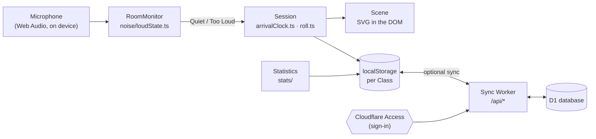

# Shy Safari

A calm classroom noise monitor: shy animals come out on the projector while
the room stays quiet.

[Français](docs/fr/README.md) · [Live site](https://www.shysafari.com) · [Changelog](CHANGELOG.md)

- [0. Status](#0-status)
- [1. What it does](#1-what-it-does)
- [2. Background](#2-background)
- [3. Tech stack](#3-tech-stack)
- [4. Installation](#4-installation)
- [5. Usage](#5-usage)
- [6. How it works](#6-how-it-works)
- [7. Version history](#7-version-history)
- [8. Credits and license](#8-credits-and-license)

## 0. Status

[](https://github.com/vant0m/shy-safari/actions/workflows/typecheck.yml)
[](https://github.com/vant0m/shy-safari/actions/workflows/tests.yml)
[](https://github.com/vant0m/shy-safari/actions/workflows/lint.yml)
[](https://github.com/vant0m/shy-safari/actions/workflows/build.yml)
[](CHANGELOG.md)
[](LICENSE.txt)
[](https://github.com/vant0m/shy-safari/commits)

**Latest version: [v1.0.0](CHANGELOG.md#100--2026-11-17) (2026-11-17).**

## 1. What it does

A calm scene on the classroom projector — a savanna, a coral reef, deep space,
the age of dinosaurs, a forest, the jungle, the Arctic or an enchanted valley —
where animals come out the longer the room stays quiet. If the room gets too
loud, they hide or run away until it is calm again. It runs in the browser;
nothing to install.


## 2. Background

- **The problem:** classroom noise meters reward noise. A bouncing needle or a
  red light makes being loud more interesting than being quiet.
- **The approach:** the opposite of a noise meter. No score, no needle, no
  warning light: a quiet room is slowly rewarded with a living scene, and
  common animals, rare ones and one legendary per scene keep it worth waiting
  for.
- **Origin:** a prototype built in three days at the 2026 EdTech-a-thon by
  [Duncan A. Johnson](https://github.com/DuncanAJohnson) and
  [Elliot Roe](https://github.com/ElliotRoe)
  ([teacherdotdev/shy-safari](https://github.com/teacherdotdev/shy-safari)),
  now maintained for long-term hosting by schools.
- **Principles:** nothing that makes noise more fun than quiet
  ([ADR 0001](docs/adr/0001-nothing-is-taken-away.md)); microphone audio
  never leaves the device; no account needed; a school's data stays its own.

## 3. Tech stack

| Technology                          | Version | Role                                    | Links                                                                                                             |
| ----------------------------------- | ------- | --------------------------------------- | ----------------------------------------------------------------------------------------------------------------- |
| Bun                                 | ≥ 1.3   | Runtime, package manager, test runner   | [site](https://bun.sh) · [GitHub](https://github.com/oven-sh/bun)                                                 |
| TypeScript                          | 6       | Language                                | [site](https://www.typescriptlang.org) · [GitHub](https://github.com/microsoft/TypeScript)                        |
| Svelte                              | 5.56    | UI                                      | [site](https://svelte.dev) · [GitHub](https://github.com/sveltejs/svelte)                                         |
| SvelteKit + adapter-static          | 2.63    | App framework, prerendered static build | [docs](https://svelte.dev/docs/kit) · [GitHub](https://github.com/sveltejs/kit)                                   |
| Vite                                | 8       | Build tool                              | [site](https://vite.dev) · [GitHub](https://github.com/vitejs/vite)                                               |
| Tailwind CSS                        | 4.3     | Styling                                 | [site](https://tailwindcss.com) · [GitHub](https://github.com/tailwindlabs/tailwindcss)                           |
| ESLint · Prettier                   | 10 · 3  | Lint, formatting                        | [ESLint](https://eslint.org) · [Prettier](https://prettier.io)                                                    |
| Cloudflare Workers (static assets)  | —       | Hosting                                 | [docs](https://developers.cloudflare.com/workers/static-assets/)                                                  |
| Wrangler                            | 4.162   | Cloudflare CLI                          | [docs](https://developers.cloudflare.com/workers/wrangler/) · [GitHub](https://github.com/cloudflare/workers-sdk) |
| Cloudflare Access · D1 _(optional)_ | —       | Sign-in, sync between computers         | [Access](https://developers.cloudflare.com/cloudflare-one/) · [D1](https://developers.cloudflare.com/d1/)         |

**Compatibility**

- Recent Chrome, Edge, Firefox or Safari, on the computer connected to the
  projector. Floating the Scene over other windows (Picture-in-Picture) needs
  Chrome or Edge.
- A microphone, and **HTTPS** (or `localhost`): browsers only give the
  microphone to secure pages.
- Interface in English, Spanish and French.
- Works with no server at all; sync between computers needs Cloudflare Access
  and D1 (free plans).

## 4. Installation

Prerequisites: [Git](https://git-scm.com) and [Bun](https://bun.sh) 1.3 or newer.

```sh
git clone https://github.com/vant0m/shy-safari.git
cd shy-safari
bun install
bun run dev      # http://localhost:5173
```

- Step-by-step local setup: [docs/running-locally.md](docs/running-locally.md)
- Hosting your own copy (Cloudflare, other static hosts, domain, access):
  [docs/hosting.md](docs/hosting.md)
- A subdomain with sign-in and sync, step by step:
  [docs/deploy-step-by-step.md](docs/deploy-step-by-step.md)
- Build variables: `PUBLIC_SITE_URL` (the site's address), `CF_BEACON_TOKEN`
  (analytics, optional), `DEV_ALLOWED_HOSTS`, `BUILD_VERSION` — see
  [docs/hosting.md](docs/hosting.md#before-you-start).

## 5. Usage

1. Open the page, pick a Scene if you like, and press **Start**. Allow the
   microphone: audio is measured on the computer, never recorded or sent.
2. Let the class work. The first animal comes after 10–20 quiet seconds, then
   about one every few minutes of quiet.
3. Move the mouse to show the controls. **Settings** sets the volume goal,
   the arrival rate and what happens when it gets too loud.

Main features:

- **Nine Scenes**, each with its own animals, ambience and "too loud" weather.
- **Classes** — one per group, each with its own animals, collection, notes,
  timer, settings and statistics.
- **Collection** — every animal a class has spotted; rare and legendary ones
  stand out.
- **Notes** and a **Timer** drawn into the Scene; the Timer's chime never
  counts as noise.
- **Statistics** — quiet time, arrivals and the noise level through the day,
  per class.
- **Export / Import** of all classes, and optional **sync** between computers.
- **Float** the Scene over your slides.

## 6. How it works



| Path                              | Role                                              |
| --------------------------------- | ------------------------------------------------- |
| `src/lib/noise/loudState.ts`      | Slow-in, fast-out "too loud" decision             |
| `src/lib/session/arrivalClock.ts` | Banking quiet time; pausing rather than resetting |
| `src/lib/session/roll.ts`         | Weighted rarity roll (60 / 30 / 10 / 0.5)         |
| `src/lib/scenes/`                 | The Scenes: rosters, SVG artwork, ambience        |
| `src/lib/sync/`, `worker/`        | Optional sync and its Cloudflare Worker           |

- **Data:** everything stays in the browser's `localStorage`, per class,
  unless a copy turns on sync ([ADR 0015](docs/adr/0015-sync-through-cloudflare.md)).
- **Details:** [docs/how-it-works.md](docs/how-it-works.md) (listening, the
  "too loud" rules, arrivals, storage, every key module).
- **Decisions:** [docs/adr/](docs/adr/README.md) · **Vocabulary:**
  [CONTEXT.md](CONTEXT.md) · **Artwork rules:**
  [docs/svg-art-brief.md](docs/svg-art-brief.md).

## 7. Version history

Versions follow [Semantic Versioning](https://semver.org/); every change is in
[CHANGELOG.md](CHANGELOG.md) ([Keep a Changelog](https://keepachangelog.com/)).

| Version                               | Date       | Highlights                                                                                                   |
| ------------------------------------- | ---------- | ------------------------------------------------------------------------------------------------------------ |
| [1.0.0](CHANGELOG.md#100--2026-11-17) | 2026-11-17 | Enchanted valley, legendary creatures, settings and statistics per class, export/import, optional sync, docs |
| [0.0.1](CHANGELOG.md#001--2026-11)    | 2026-11    | EdTech-a-thon prototype: seven Scenes and Pumpkin Hollow, classes, notes, timer                              |

## 8. Credits and license

- **Original project and authors:** created during the 2026 EdTech-a-thon by
  [Duncan A. Johnson](https://github.com/DuncanAJohnson) and
  [Elliot Roe](https://github.com/ElliotRoe), published at
  [teacherdotdev/shy-safari](https://github.com/teacherdotdev/shy-safari).
  This repository is a fork that builds on their work.
- **Contributors:** see the
  [contributors graph](https://github.com/vant0m/shy-safari/graphs/contributors).
- **License:** Apache License 2.0 — see [LICENSE.txt](LICENSE.txt) and
  [NOTICE](NOTICE).

### Contributing

Before committing: `bun run check && bun test && bun run lint && bun run build`.
Commits follow [Conventional Commits](https://www.conventionalcommits.org/);
see [AGENTS.md](AGENTS.md) for project notes.
