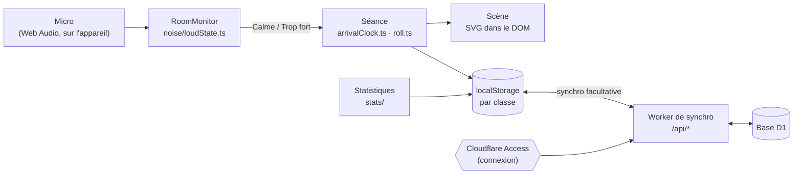

# Shy Safari

Un sonomètre de classe tout en douceur : des animaux timides sortent au
vidéoprojecteur tant que la salle reste calme.

[English](../../README.md) · [Site en ligne](https://www.shysafari.com) · [Historique des versions](CHANGELOG.md)

- [0. État](#0-état)
- [1. Ce que fait l'application](#1-ce-que-fait-lapplication)
- [2. Contexte](#2-contexte)
- [3. Technologies](#3-technologies)
- [4. Installation](#4-installation)
- [5. Utilisation](#5-utilisation)
- [6. Fonctionnement](#6-fonctionnement)
- [7. Historique des versions](#7-historique-des-versions)
- [8. Crédits et licence](#8-crédits-et-licence)

## 0. État

[](https://github.com/vant0m/shy-safari/actions/workflows/typecheck.yml)
[](https://github.com/vant0m/shy-safari/actions/workflows/tests.yml)
[](https://github.com/vant0m/shy-safari/actions/workflows/lint.yml)
[](https://github.com/vant0m/shy-safari/actions/workflows/build.yml)
[](CHANGELOG.md)
[](../../LICENSE.txt)
[](https://github.com/vant0m/shy-safari/commits)

**Dernière version : [v1.0.0](CHANGELOG.md#100--2026-11-17) (17/11/2026).**

## 1. Ce que fait l'application

Une scène paisible au vidéoprojecteur — savane, récif de corail, espace
profond, préhistoire, forêt, jungle, Arctique ou vallée enchantée — où des
animaux sortent tant que la classe reste calme. Si la salle devient trop
bruyante, ils se cachent ou s'enfuient jusqu'au retour du calme. Tout se passe
dans le navigateur, rien à installer.


## 2. Contexte

- **Le problème :** les sonomètres de classe récompensent le bruit. Une
  aiguille qui s'agite ou un voyant rouge rendent le bruit plus intéressant
  que le calme.
- **L'approche :** l'inverse d'un sonomètre. Pas de score, pas d'aiguille, pas
  de voyant : une salle calme est peu à peu récompensée par une scène vivante,
  avec des animaux communs, des rares et un légendaire par scène.
- **Origine :** un prototype créé en trois jours à l'EdTech-a-thon 2026 par
  [Duncan A. Johnson](https://github.com/DuncanAJohnson) et
  [Elliot Roe](https://github.com/ElliotRoe)
  ([teacherdotdev/shy-safari](https://github.com/teacherdotdev/shy-safari)),
  désormais maintenu pour un hébergement durable par des établissements.
- **Principes :** rien ne doit rendre le bruit plus amusant que le calme
  ([ADR 0001](../adr/0001-nothing-is-taken-away.md)) ; le son du micro ne
  quitte jamais l'appareil ; aucun compte nécessaire ; les données d'un
  établissement restent les siennes.

## 3. Technologies

| Technologie                             | Version | Rôle                                         | Liens                                                                                                            |
| --------------------------------------- | ------- | -------------------------------------------- | ---------------------------------------------------------------------------------------------------------------- |
| Bun                                     | ≥ 1.3   | Runtime, gestionnaire de paquets, tests      | [site](https://bun.sh) · [GitHub](https://github.com/oven-sh/bun)                                                |
| TypeScript                              | 6       | Langage                                      | [site](https://www.typescriptlang.org) · [GitHub](https://github.com/microsoft/TypeScript)                       |
| Svelte                                  | 5.56    | Interface                                    | [site](https://svelte.dev) · [GitHub](https://github.com/sveltejs/svelte)                                        |
| SvelteKit + adapter-static              | 2.63    | Framework, build statique prérendu           | [doc](https://svelte.dev/docs/kit) · [GitHub](https://github.com/sveltejs/kit)                                   |
| Vite                                    | 8       | Outil de build                               | [site](https://vite.dev) · [GitHub](https://github.com/vitejs/vite)                                              |
| Tailwind CSS                            | 4.3     | Styles                                       | [site](https://tailwindcss.com) · [GitHub](https://github.com/tailwindlabs/tailwindcss)                          |
| ESLint · Prettier                       | 10 · 3  | Analyse, formatage                           | [ESLint](https://eslint.org) · [Prettier](https://prettier.io)                                                   |
| Cloudflare Workers (fichiers statiques) | —       | Hébergement                                  | [doc](https://developers.cloudflare.com/workers/static-assets/)                                                  |
| Wrangler                                | 4.162   | Outil en ligne de commande Cloudflare        | [doc](https://developers.cloudflare.com/workers/wrangler/) · [GitHub](https://github.com/cloudflare/workers-sdk) |
| Cloudflare Access · D1 _(facultatif)_   | —       | Connexion, synchronisation entre ordinateurs | [Access](https://developers.cloudflare.com/cloudflare-one/) · [D1](https://developers.cloudflare.com/d1/)        |

**Compatibilité**

- Chrome, Edge, Firefox ou Safari récents, sur l'ordinateur relié au
  vidéoprojecteur. La fenêtre flottante (Picture-in-Picture) demande Chrome ou
  Edge.
- Un micro, et **HTTPS** (ou `localhost`) : les navigateurs ne donnent le
  micro qu'aux pages sécurisées.
- Interface en anglais, espagnol et français.
- Fonctionne sans aucun serveur ; la synchronisation entre ordinateurs demande
  Cloudflare Access et D1 (offres gratuites).

## 4. Installation

Prérequis : [Git](https://git-scm.com) et [Bun](https://bun.sh) 1.3 ou plus.

```sh
git clone https://github.com/vant0m/shy-safari.git
cd shy-safari
bun install
bun run dev      # http://localhost:5173
```

- Lancement local pas à pas : [lancer-en-local.md](lancer-en-local.md)
- Héberger votre copie (Cloudflare, autres hébergeurs, domaine, accès) :
  [hebergement.md](hebergement.md)
- Un sous-domaine avec connexion et synchronisation, pas à pas :
  [deploiement-pas-a-pas.md](deploiement-pas-a-pas.md)
- Variables de build : `PUBLIC_SITE_URL` (adresse du site), `CF_BEACON_TOKEN`
  (statistiques de visite, facultatif), `DEV_ALLOWED_HOSTS`, `BUILD_VERSION`
  — voir [hebergement.md](hebergement.md#avant-de-commencer).

## 5. Utilisation

1. Ouvrez la page, choisissez une scène si vous le souhaitez, puis appuyez sur
   **Commencer**. Autorisez le micro : le son est mesuré sur l'ordinateur,
   jamais enregistré ni envoyé.
2. Laissez la classe travailler. Le premier animal arrive après 10 à 20
   secondes de calme, puis environ un toutes les quelques minutes de calme.
3. Bougez la souris pour afficher les commandes. **Réglages** fixe l'objectif
   de volume, la fréquence d'arrivée et ce qui se passe quand c'est trop fort.

Fonctions principales :

- **Neuf scènes**, chacune avec ses animaux, son ambiance et sa « météo » quand
  c'est trop fort.
- **Classes** — une par groupe, avec ses animaux, sa collection, ses notes,
  son minuteur, ses réglages et ses statistiques.
- **Collection** — tous les animaux aperçus par une classe ; rares et
  légendaires mis en valeur.
- **Notes** et **minuteur** intégrés au décor ; la sonnerie du minuteur ne
  compte jamais comme du bruit.
- **Statistiques** — temps calme, arrivées et niveau sonore au fil de la
  journée, par classe.
- **Exporter / Importer** toutes les classes, et **synchronisation**
  facultative entre ordinateurs.
- **Fenêtre flottante** au-dessus de vos diapositives.

## 6. Fonctionnement



| Chemin                            | Rôle                                                    |
| --------------------------------- | ------------------------------------------------------- |
| `src/lib/noise/loudState.ts`      | Décision « trop fort », lente à entrer, rapide à sortir |
| `src/lib/session/arrivalClock.ts` | Temps calme accumulé, mis en pause sans remise à zéro   |
| `src/lib/session/roll.ts`         | Tirage pondéré par rareté (60 / 30 / 10 / 0,5)          |
| `src/lib/scenes/`                 | Les scènes : animaux, dessins SVG, ambiance             |
| `src/lib/sync/`, `worker/`        | Synchronisation facultative et son Worker Cloudflare    |

- **Données :** tout reste dans le `localStorage` du navigateur, par classe,
  sauf si une copie active la synchronisation
  ([ADR 0015](../adr/0015-sync-through-cloudflare.md)).
- **Détails :** [fonctionnement.md](fonctionnement.md) (écoute, règles « trop
  fort », arrivées, stockage, modules clés).
- **Décisions :** [ADR](../adr/README.md) (en anglais) · **Vocabulaire :**
  [CONTEXT.md](../../CONTEXT.md) · **Règles de dessin :**
  [svg-art-brief.md](../svg-art-brief.md).

## 7. Historique des versions

Les versions suivent [SemVer](https://semver.org/lang/fr/) ; tous les
changements sont dans l'[historique des versions](CHANGELOG.md)
([Keep a Changelog](https://keepachangelog.com/fr/)).

| Version                               | Date       | Points forts                                                                                                          |
| ------------------------------------- | ---------- | --------------------------------------------------------------------------------------------------------------------- |
| [1.0.0](CHANGELOG.md#100--2026-11-17) | 2026-11-17 | Vallée enchantée, légendaires, réglages et statistiques par classe, export/import, synchro facultative, documentation |
| [0.0.1](CHANGELOG.md#001--2026-11)    | 2026-11    | Prototype de l'EdTech-a-thon : sept scènes et Pumpkin Hollow, classes, notes, minuteur                                |

## 8. Crédits et licence

- **Projet et auteurs d'origine :** créé pendant l'EdTech-a-thon 2026 par
  [Duncan A. Johnson](https://github.com/DuncanAJohnson) et
  [Elliot Roe](https://github.com/ElliotRoe), publié sur
  [teacherdotdev/shy-safari](https://github.com/teacherdotdev/shy-safari). Ce
  dépôt est un fork qui s'appuie sur leur travail.
- **Contributeurs :** voir le
  [graphe des contributeurs](https://github.com/vant0m/shy-safari/graphs/contributors).
- **Licence :** Apache 2.0 — voir [LICENSE.txt](../../LICENSE.txt) et
  [NOTICE](../../NOTICE).

### Contribuer

Avant de commiter : `bun run check && bun test && bun run lint && bun run build`.
Les commits suivent [Conventional Commits](https://www.conventionalcommits.org/fr/) ;
voir [AGENTS.md](../../AGENTS.md) pour les notes du projet.
