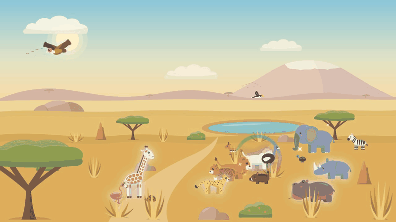
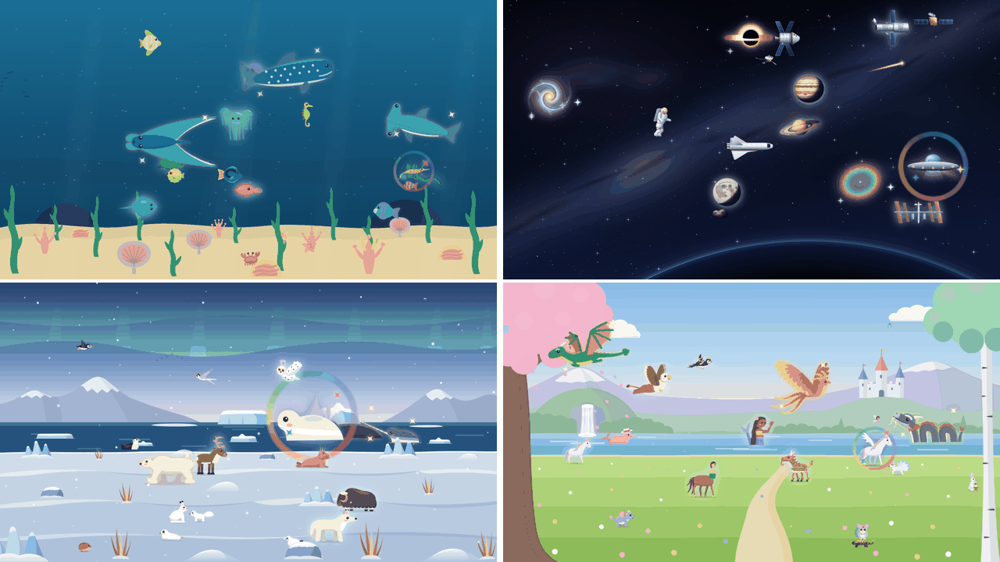
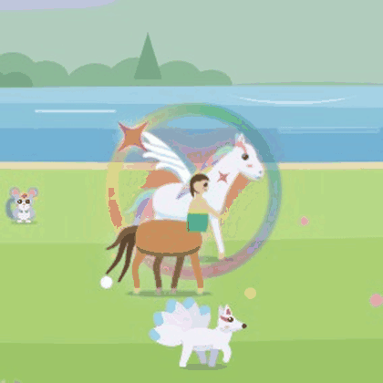
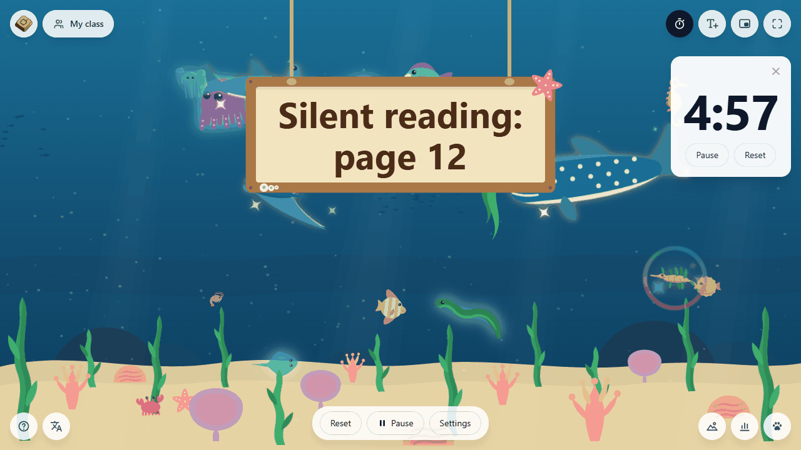
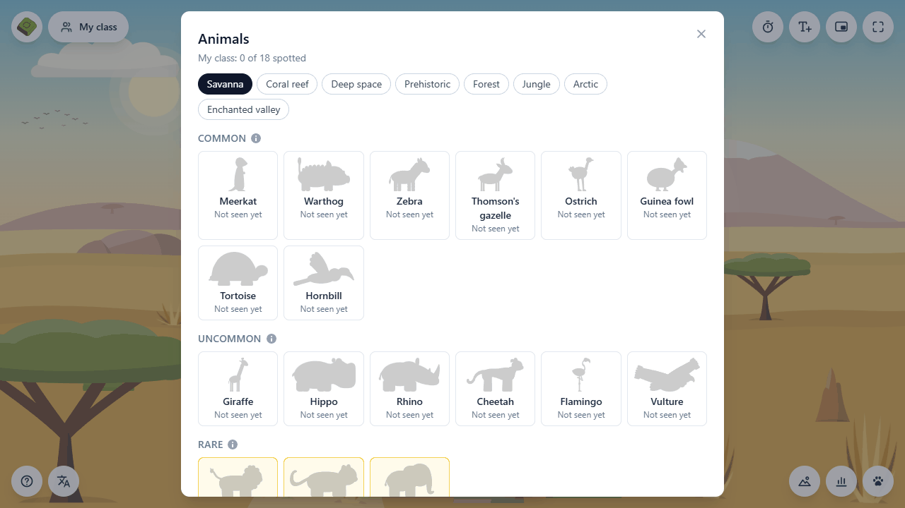
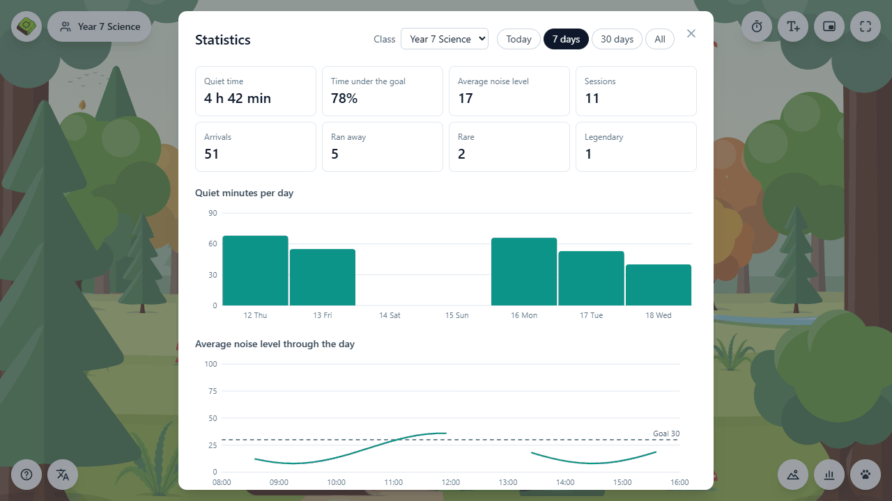
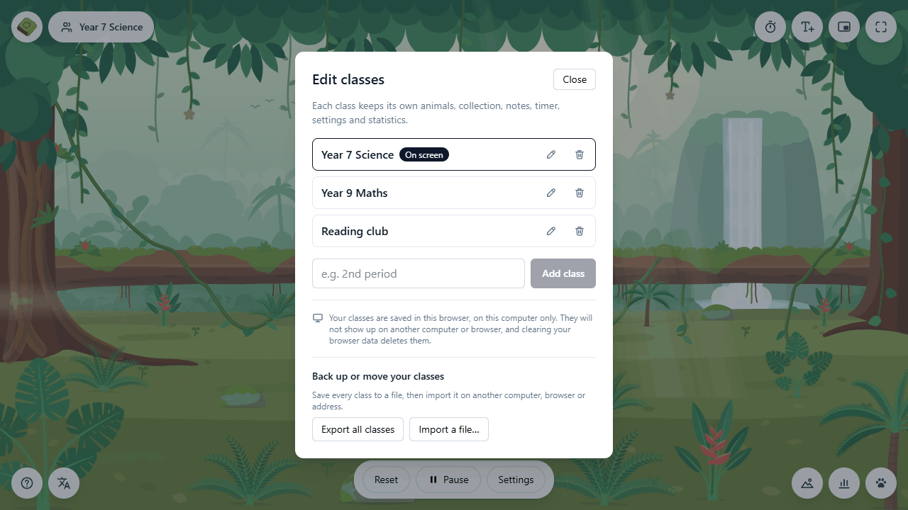
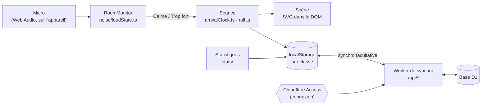

<a name="readme-top"></a>

<div align="center">


# Shy Safari

_Un sonomètre de classe qui récompense le calme. Criez, et les animaux se cachent._

[Installer](#installer) • [Utiliser](#utiliser) • [Fonctionnement](#fonctionnement) • [Site en ligne](https://www.shysafari.com) • [Versions](CHANGELOG.md) • [English](../../README.md)

[![Typecheck][badge-typecheck]][ci-typecheck]
[![Tests][badge-tests]][ci-tests]
[![Lint][badge-lint]][ci-lint]
[![Build][badge-build]][ci-build]

[![Version][badge-version]](CHANGELOG.md)
[![Licence][badge-license]](../../LICENSE.txt)
[![Dernier commit][badge-commit]][commits]



</div>

<details>
<summary><kbd>Sommaire</kbd></summary>

- [🚦 État](#etat)
- [✨ Ce que fait l'application](#presentation)
- [📖 Contexte](#contexte)
- [🧰 Technologies](#technologies)
- [🚀 Installer](#installer)
  - [Prérequis](#prerequis)
  - [Démarrage rapide](#demarrage-rapide)
  - [Pour aller plus loin](#aller-plus-loin)
  - [Variables de build](#variables)
- [🎮 Utiliser](#utiliser)
- [⚙️ Fonctionnement](#fonctionnement)
- [🗓️ Historique des versions](#versions)
- [🙏 Crédits et licence](#credits)

</details>

## <a name="etat"></a>🚦 État

| Vérification                     | État                                                                 |
| -------------------------------- | -------------------------------------------------------------------- |
| Typecheck · Tests · Lint · Build | voir les badges ci-dessus (GitHub Actions, un workflow chacun)       |
| Dernière version                 | **[v1.0.0](CHANGELOG.md#100--2026-11-17)** — 17/11/2026              |
| En ligne                         | [www.shysafari.com](https://www.shysafari.com) (le projet d'origine) |

<div align="right">

[![][back-to-top]](#readme-top)

</div>

## <a name="presentation"></a>✨ Ce que fait l'application

Une scène paisible au vidéoprojecteur — savane, récif de corail, espace
profond, préhistoire, forêt, jungle, Arctique ou vallée enchantée — où des
animaux sortent tant que la classe reste calme. Si c'est trop bruyant, ils se
cachent ou s'enfuient jusqu'au retour du calme. Tout se passe dans le
navigateur, rien à installer.

**Principes**

- **Le calme est récompensé, le bruit n'est jamais amusant.** Pas de score,
  pas d'aiguille, pas de voyant rouge
  ([ADR 0001](../adr/0001-nothing-is-taken-away.md)).
- **Le son ne quitte jamais l'appareil.** Le micro est mesuré, pas enregistré.
- **Aucun compte nécessaire.** Un établissement peut ajouter une connexion
  s'il le souhaite.
- **Les données d'un établissement restent les siennes.** Dans le navigateur
  par défaut ; sur son propre compte Cloudflare s'il active la
  synchronisation.

<div align="right">

[![][back-to-top]](#readme-top)

</div>

## <a name="contexte"></a>📖 Contexte

- **Le problème :** les sonomètres de classe récompensent le bruit — une
  aiguille qui s'agite ou un voyant rouge rendent le bruit plus intéressant
  que le calme.
- **L'approche :** l'inverse d'un sonomètre. Une salle calme est peu à peu
  récompensée par une scène vivante ; animaux communs, rares et un légendaire
  par scène donnent envie d'attendre.
- **Origine :** un prototype créé en trois jours à l'EdTech-a-thon 2026 par
  [Duncan A. Johnson](https://github.com/DuncanAJohnson) et
  [Elliot Roe](https://github.com/ElliotRoe)
  ([teacherdotdev/shy-safari](https://github.com/teacherdotdev/shy-safari)),
  désormais maintenu pour un hébergement durable par des établissements.

<div align="right">

[![][back-to-top]](#readme-top)

</div>

## <a name="technologies"></a>🧰 Technologies

| Technologie                | Version | Rôle                                      | Liens                                                                          |
| -------------------------- | ------- | ----------------------------------------- | ------------------------------------------------------------------------------ |
| Bun                        | ≥ 1.3   | Runtime, gestionnaire de paquets, tests   | [site](https://bun.sh) · [GitHub](https://github.com/oven-sh/bun)              |
| Svelte                     | 5.56    | Interface                                 | [site](https://svelte.dev) · [GitHub](https://github.com/sveltejs/svelte)      |
| SvelteKit + adapter-static | 2.63    | Framework, build statique prérendu        | [doc](https://svelte.dev/docs/kit) · [GitHub](https://github.com/sveltejs/kit) |
| Cloudflare Workers         | —       | Hébergement (fichiers statiques, synchro) | [doc](https://developers.cloudflare.com/workers/static-assets/)                |

<details>
<summary>🔹 <b>Tous les outils et services</b></summary>

| Technologie                           | Version | Rôle                                  | Liens                                                                                                            |
| ------------------------------------- | ------- | ------------------------------------- | ---------------------------------------------------------------------------------------------------------------- |
| TypeScript                            | 6       | Langage                               | [site](https://www.typescriptlang.org) · [GitHub](https://github.com/microsoft/TypeScript)                       |
| Vite                                  | 8       | Outil de build                        | [site](https://vite.dev) · [GitHub](https://github.com/vitejs/vite)                                              |
| Tailwind CSS                          | 4.3     | Styles                                | [site](https://tailwindcss.com) · [GitHub](https://github.com/tailwindlabs/tailwindcss)                          |
| ESLint · Prettier                     | 10 · 3  | Analyse, formatage                    | [ESLint](https://eslint.org) · [Prettier](https://prettier.io)                                                   |
| Wrangler                              | 4.162   | Outil en ligne de commande Cloudflare | [doc](https://developers.cloudflare.com/workers/wrangler/) · [GitHub](https://github.com/cloudflare/workers-sdk) |
| Cloudflare Access · D1 _(facultatif)_ | —       | Connexion, synchronisation            | [Access](https://developers.cloudflare.com/cloudflare-one/) · [D1](https://developers.cloudflare.com/d1/)        |
| GitHub Actions                        | —       | Typecheck, tests, lint, build         | [workflows](../../.github/workflows/)                                                                            |

</details>

**Compatibilité**

- Chrome, Edge, Firefox ou Safari récents ; la fenêtre flottante
  (Picture-in-Picture) demande Chrome ou Edge.
- Interface en anglais, espagnol et français.
- Fonctionne sans aucun serveur ; la synchronisation demande Cloudflare Access
  et D1 (offres gratuites).

> [!IMPORTANT]
> Le micro ne fonctionne qu'en **HTTPS** (ou sur `localhost`) : les navigateurs
> le refusent aux pages non sécurisées.

<div align="right">

[![][back-to-top]](#readme-top)

</div>

## <a name="installer"></a>🚀 Installer

### <a name="prerequis"></a>Prérequis

| Outil                     | Version                                                  | Windows                                         | macOS / Linux                               | Lien                                               |
| ------------------------- | -------------------------------------------------------- | ----------------------------------------------- | ------------------------------------------- | -------------------------------------------------- |
| Git                       | récente                                                  | `winget install Git.Git`                        | `brew install git` · `apt install git`      | [git-scm.com](https://git-scm.com)                 |
| Bun                       | ≥ 1.3                                                    | `powershell -c "irm bun.sh/install.ps1 \| iex"` | `curl -fsSL https://bun.sh/install \| bash` | [bun.sh](https://bun.sh)                           |
| Navigateur                | Chrome, Edge, Firefox ou Safari récent                   | —                                               | —                                           | —                                                  |
| Cloudflare _(facultatif)_ | compte gratuit ; Wrangler est installé par `bun install` | —                                               | —                                           | [dash.cloudflare.com](https://dash.cloudflare.com) |

### <a name="demarrage-rapide"></a>Démarrage rapide

```sh
git clone https://github.com/vant0m/shy-safari.git
cd shy-safari
bun install
bun run dev      # http://localhost:5173
```

### <a name="aller-plus-loin"></a>Pour aller plus loin

- Lancement local pas à pas : [lancer-en-local.md](lancer-en-local.md)
- Héberger votre copie (Cloudflare, autres hébergeurs, domaine, connexion) :
  [hebergement.md](hebergement.md)
- Un sous-domaine avec connexion et synchronisation, pas à pas :
  [deploiement-pas-a-pas.md](deploiement-pas-a-pas.md)

### <a name="variables"></a>Variables de build

<details>
<summary>🔹 <b>Afficher les variables</b></summary>

| Variable            | Effet                                                                                      |
| ------------------- | ------------------------------------------------------------------------------------------ |
| `PUBLIC_SITE_URL`   | Adresse du site (liens canoniques, sitemap, aide). Par défaut `https://www.shysafari.com`. |
| `CF_BEACON_TOKEN`   | Ajoute Cloudflare Web Analytics. Laissez vide pour n'en avoir aucune.                      |
| `DEV_ALLOWED_HOSTS` | Noms d'hôte acceptés par le serveur de dev derrière un tunnel ou un proxy.                 |
| `BUILD_VERSION`     | Nom de version du build (par défaut : le commit git).                                      |

</details>

<div align="right">

[![][back-to-top]](#readme-top)

</div>

## <a name="utiliser"></a>🎮 Utiliser

1. Ouvrez la page, choisissez une scène, appuyez sur **Commencer** et
   autorisez le micro.
2. Laissez la classe travailler : le premier animal arrive après 10 à 20
   secondes de calme, puis environ un toutes les quelques minutes de calme.
3. Bougez la souris pour afficher les commandes ; **Réglages** fixe l'objectif
   de volume, la fréquence d'arrivée et ce qui se passe quand c'est trop fort.

<table align="center">
<tr>
<td align="center" width="50%">
<b>🌍 Huit scènes, plus Halloween et Noël</b><br>
<a href="../images/scenes.png"></a><br>
<sub>Chacune avec ses animaux, son ambiance et sa « météo » quand c'est trop fort.</sub>
</td>
<td align="center" width="50%">
<b>🌈 Créatures légendaires</b><br>
<a href="../images/legendary.gif"></a><br>
<sub>Une par scène, environ une arrivée sur deux cents, sous un arc-en-ciel.</sub>
</td>
</tr>
<tr>
<td align="center" width="50%">
<b>📝 Notes et minuteur</b><br>
<a href="../images/notes-timer.png"></a><br>
<sub>Des consignes intégrées au décor ; la sonnerie ne compte jamais comme du bruit.</sub>
</td>
<td align="center" width="50%">
<b>🗂️ Collection</b><br>
<a href="../images/collection.png"></a><br>
<sub>Tous les animaux aperçus par une classe ; rares et légendaires mis en valeur.</sub>
</td>
</tr>
<tr>
<td align="center" width="50%">
<b>📊 Statistiques</b><br>
<a href="../images/statistics.png"></a><br>
<sub>Temps calme, arrivées et bruit au fil de la journée, classes comparées.</sub>
</td>
<td align="center" width="50%">
<b>👥 Classes, sauvegarde et synchro</b><br>
<a href="../images/classes.png"></a><br>
<sub>Une classe par groupe ; exportez-les toutes dans un fichier.</sub>
</td>
</tr>
</table>

> [!TIP]
> Un établissement qui héberge sa copie peut activer la **synchronisation** :
> les enseignants se connectent avec un code reçu par e-mail et retrouvent
> leurs classes sur n'importe quel ordinateur
> ([guide](deploiement-pas-a-pas.md)).

<div align="right">

[![][back-to-top]](#readme-top)

</div>

## <a name="fonctionnement"></a>⚙️ Fonctionnement



<details>
<summary>🔹 <b>Modules clés</b></summary>

| Chemin                            | Rôle                                                    |
| --------------------------------- | ------------------------------------------------------- |
| `src/lib/app.svelte.ts`           | Câblage : micro → surveillance de la salle → séance     |
| `src/lib/noise/loudState.ts`      | Décision « trop fort », lente à entrer, rapide à sortir |
| `src/lib/session/arrivalClock.ts` | Temps calme accumulé, mis en pause sans remise à zéro   |
| `src/lib/session/roll.ts`         | Tirage pondéré par rareté (60 / 30 / 10 / 0,5)          |
| `src/lib/scenes/`                 | Les scènes : animaux, dessins SVG, ambiance             |
| `src/lib/stats/`                  | Statistiques par classe                                 |
| `src/lib/sync/`, `worker/`        | Synchronisation facultative et son Worker Cloudflare    |

</details>

- **Données :** dans le `localStorage` du navigateur, par classe, sauf si une
  copie active la synchronisation
  ([ADR 0015](../adr/0015-sync-through-cloudflare.md)).
- **Plus :** [fonctionnement.md](fonctionnement.md) ·
  [décisions (ADR, en anglais)](../adr/README.md) ·
  [vocabulaire](../../CONTEXT.md) · [règles de dessin](../svg-art-brief.md)

> [!NOTE]
> Le son du micro est mesuré dans le navigateur, jamais enregistré ni envoyé,
> avec ou sans synchronisation.

<div align="right">

[![][back-to-top]](#readme-top)

</div>

## <a name="versions"></a>🗓️ Historique des versions

Les versions suivent [SemVer](https://semver.org/lang/fr/) ; tous les
changements sont dans l'[historique des versions](CHANGELOG.md)
([Keep a Changelog](https://keepachangelog.com/fr/)).

| Version                               | Date       | Points forts                                                                                                          |
| ------------------------------------- | ---------- | --------------------------------------------------------------------------------------------------------------------- |
| [1.0.0](CHANGELOG.md#100--2026-11-17) | 2026-11-17 | Vallée enchantée, légendaires, réglages et statistiques par classe, export/import, synchro facultative, documentation |
| [0.0.1](CHANGELOG.md#001--2026-11)    | 2026-11    | Prototype de l'EdTech-a-thon : sept scènes et Pumpkin Hollow, classes, notes, minuteur                                |

<div align="right">

[![][back-to-top]](#readme-top)

</div>

## <a name="credits"></a>🙏 Crédits et licence

- **Projet et auteurs d'origine :** créé pendant l'EdTech-a-thon 2026 par
  [Duncan A. Johnson](https://github.com/DuncanAJohnson) et
  [Elliot Roe](https://github.com/ElliotRoe), publié sur
  [teacherdotdev/shy-safari](https://github.com/teacherdotdev/shy-safari). Ce
  dépôt est un fork qui s'appuie sur leur travail.
- **Licence :** Apache 2.0 — voir [LICENSE.txt](../../LICENSE.txt) et
  [NOTICE](../../NOTICE).

**Contributeurs**

[][contributors]

**Contribuer** — avant de commiter :
`bun run check && bun test && bun run lint && bun run build`. Les commits
suivent [Conventional Commits](https://www.conventionalcommits.org/fr/) ; notes
du projet dans [AGENTS.md](../../AGENTS.md).

<div align="right">

[![][back-to-top]](#readme-top)

</div>

[badge-typecheck]: https://img.shields.io/github/actions/workflow/status/vant0m/shy-safari/typecheck.yml?branch=main&label=typecheck&style=flat-square
[badge-tests]: https://img.shields.io/github/actions/workflow/status/vant0m/shy-safari/tests.yml?branch=main&label=tests&style=flat-square
[badge-lint]: https://img.shields.io/github/actions/workflow/status/vant0m/shy-safari/lint.yml?branch=main&label=lint&style=flat-square
[badge-build]: https://img.shields.io/github/actions/workflow/status/vant0m/shy-safari/build.yml?branch=main&label=build&style=flat-square
[badge-version]: https://img.shields.io/github/v/tag/vant0m/shy-safari?label=version&sort=semver&style=flat-square
[badge-license]: https://img.shields.io/github/license/vant0m/shy-safari?label=licence&style=flat-square
[badge-commit]: https://img.shields.io/github/last-commit/vant0m/shy-safari?label=dernier%20commit&style=flat-square
[ci-typecheck]: https://github.com/vant0m/shy-safari/actions/workflows/typecheck.yml
[ci-tests]: https://github.com/vant0m/shy-safari/actions/workflows/tests.yml
[ci-lint]: https://github.com/vant0m/shy-safari/actions/workflows/lint.yml
[ci-build]: https://github.com/vant0m/shy-safari/actions/workflows/build.yml
[commits]: https://github.com/vant0m/shy-safari/commits
[contributors]: https://github.com/vant0m/shy-safari/graphs/contributors
[back-to-top]: https://img.shields.io/badge/-BACK_TO_TOP-151515?style=flat-square
