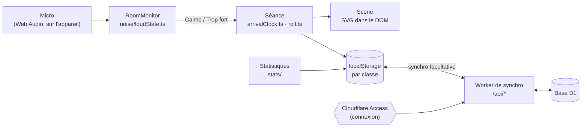

# Fonctionnement de Shy Safari

Le détail technique derrière la [section 6 du README](README.md#fonctionnement).
Version anglaise : [../how-it-works.md](../how-it-works.md). Vocabulaire :
[CONTEXT.md](../../CONTEXT.md) ; décisions : [ADR](../adr/README.md) (en
anglais).

## Écouter la salle

- Le micro est mesuré dans le navigateur (Web Audio). Rien n'est enregistré
  ni envoyé. Le niveau est sur une échelle 0–100, la même que l'objectif de
  volume ; ce ne sont pas des décibels.
- La **calibration** est facultative : cinq secondes de silence et cinq de
  conversation normale adaptent l'échelle à la salle et au micro.
- **Objectif de volume** : Silence, Travail seul, En binôme, ou
  n'importe où entre les deux en faisant glisser la ligne. **Afficher à
  l'écran** garde le sonomètre au-dessus de la scène.

## Décider que c'est trop fort

Dépasser la ligne n'arrête rien instantanément
(`src/lib/noise/loudState.ts`). Le bruit au-dessus de l'objectif remplit un
« seau », d'autant plus vite que l'on est loin au-dessus : environ **six
secondes** juste au-dessus, environ **une seconde** très au-dessus. Les moments
calmes le vident : une porte qui claque ou un livre qui tombe ne coûte rien.
Le retour au calme ne prend que **trois secondes**.

## Ce que fait « trop fort »

La scène se voile à sa manière (brume de poussière, eau trouble,
interférences, brume, brouillard, averse, blizzard, brume lilas) et les
arrivées s'arrêtent. Ensuite, selon le réglage de la classe :

- **Les animaux s'enfuient** (par défaut,
  [ADR 0003](../adr/0003-animals-can-run-away.md)) : au bout de trois
  secondes, un animal sursaute et part en avertissement ; puis toutes les cinq
  secondes, un cinquième de ceux qui restent s'en va tant que c'est trop fort.
- **Mettre la scène en pause** ([ADR 0001](../adr/0001-nothing-is-taken-away.md)) :
  aucun animal ne part ; la progression vers le prochain s'arrête sans être
  remise à zéro.

Quand l'enseignant met en **pause** pour parler, ou que le minuteur sonne, la
salle n'est pas jugée.

## Arrivées et rareté

- **Horloge d'arrivée** (`src/lib/session/arrivalClock.ts`) : une scène vide
  reçoit son premier animal après 10 à 20 secondes de calme ; ensuite un par
  intervalle de temps calme accumulé (5 minutes par défaut).
- **Tirage** (`src/lib/session/roll.ts`) : communs 60, peu communs 30, rares
  10, légendaires 0,5. Un rare vient au plus une fois tant qu'il est à l'écran,
  un légendaire au plus une fois par séance
  ([ADR 0012](../adr/0012-legendary-tier.md)).

## Dessiner la scène

Chaque scène est du SVG dans le DOM, pas de la vidéo ni du canvas
([ADR 0002](../adr/0002-svg-dom-scene.md)) : chaque animal est un élément
ordinaire animé en CSS, accessible et léger pour l'ordinateur du
vidéoprojecteur. Règles de dessin : [svg-art-brief.md](../svg-art-brief.md).

## Où sont les données

- Tout est dans le `localStorage` du navigateur, sous le préfixe
  `class-noise-level:`, par classe : animaux par scène, Collection, Notes,
  Minuteur, réglages de classe et statistiques. Les changements de format
  migrent les anciennes données au lieu de les effacer.
- **Exporter / Importer** déplace le tout dans un fichier JSON.
- **Synchronisation facultative**
  ([ADR 0015](../adr/0015-sync-through-cloudflare.md)) : un Worker sous
  `/api/*` vérifie la connexion Cloudflare Access et garde la sauvegarde de
  chaque enseignant dans D1 ; l'app fusionne les changements faits sur deux
  ordinateurs et ne recharge jamais la page ni ne pose de question pendant une
  séance.

## Repères dans le code

| Chemin                            | Rôle                                                    |
| --------------------------------- | ------------------------------------------------------- |
| `src/lib/app.svelte.ts`           | Câblage : micro → surveillance de la salle → séance     |
| `src/lib/noise/loudState.ts`      | Décision « trop fort », lente à entrer, rapide à sortir |
| `src/lib/session/arrivalClock.ts` | Temps calme accumulé, mis en pause sans remise à zéro   |
| `src/lib/session/roll.ts`         | Tirage pondéré par rareté                               |
| `src/lib/scenes/index.ts`         | Registre des scènes                                     |
| `src/lib/settings/stored.ts`      | Réglages de la salle / de la classe                     |
| `src/lib/backup/backup.ts`        | Export et import                                        |
| `src/lib/stats/statsData.ts`      | Enregistrement et calcul des statistiques               |
| `src/lib/sync/syncLogic.ts`       | Décisions de synchro et fusion à trois voies            |
| `worker/`                         | API de synchro, vérification Access, stockage D1        |
| `src/lib/i18n/index.svelte.ts`    | Tous les textes (anglais, espagnol, français)           |
