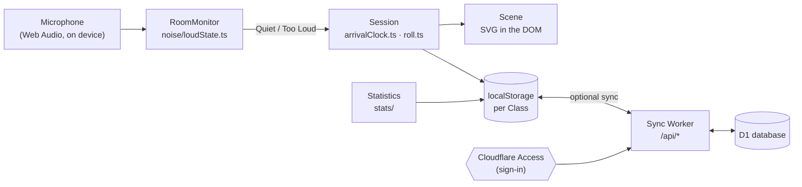

# How Shy Safari works

The technical picture behind [README §6](../README.md#how-it-works).
French version: [fr/fonctionnement.md](fr/fonctionnement.md). Vocabulary:
[CONTEXT.md](../CONTEXT.md); decisions: [adr/](adr/README.md).

## Listening to the room

- The microphone is measured in the browser (Web Audio). Nothing is recorded
  or sent anywhere. The level is a 0–100 scale, the same one the Volume Goal
  is set on; it is not decibels.
- **Calibration** is optional: five seconds of silence and five of normal
  talking fit the scale to the room and the microphone.
- **Volume Goal**: Silent, Independent or Partner work, or anywhere in
  between by dragging the line on the meter. **Show on screen** keeps the
  meter over the Scene.

## Deciding the room is too loud

Going over the line does not instantly stop anything
(`src/lib/noise/loudState.ts`). Noise over the goal fills up a bucket, and
the further over, the faster it fills: just over the line takes about **six
seconds** to count as Too Loud, far over about **one second**. Quiet moments
drain it again, so a knock at the door or a dropped book costs nothing.
Recovery takes only **three seconds**: a class that settles down is rewarded
at once rather than serving a sentence.

## What Too Loud does

The Scene clouds over in its own way (dusty haze, murky water, interference,
river mist, fog, a downpour, a whiteout, a lilac mist), and arrivals pause.
Then, depending on the Class's setting:

- **Animals run away** (default, [ADR 0003](adr/0003-animals-can-run-away.md)):
  three seconds in, one Creature is startled and runs as a warning; every five
  seconds after that, a fifth of those still out leave while it stays Too
  Loud.
- **Pause the scene** ([ADR 0001](adr/0001-nothing-is-taken-away.md)):
  nothing already out leaves; progress towards the next arrival pauses rather
  than resetting, so a loud spell costs exactly the time it lasted.

While the teacher **pauses** to talk, or the Timer's chime rings, the room is
not judged at all.

## Arrivals and rarity

- **Arrival clock** (`src/lib/session/arrivalClock.ts`): an empty Scene gets
  its first Creature after 10–20 quiet seconds as a teaser; after that, one
  per Arrival Rate of banked quiet time (5 minutes by default).
- **Rarity roll** (`src/lib/session/roll.ts`): Common 60, Uncommon 30, Rare
  10, Legendary 0.5. A Rare comes at most once while it is on screen, a
  Legendary at most once per Session ([ADR 0012](adr/0012-legendary-tier.md)).
  The limited-time Scenes, Pumpkin Hollow and the Christmas chalet, are only
  on offer for a few weeks a year, with their whole Roster from the first
  day and no Legendary ([ADR 0016](adr/0016-christmas-chalet.md)).

## Drawing the Scene

Every Scene is SVG in the DOM rather than video or canvas
([ADR 0002](adr/0002-svg-dom-scene.md)): each Creature is an ordinary element
that CSS animates, which keeps it accessible and light on a projector laptop.
The rules every drawing follows are in [svg-art-brief.md](svg-art-brief.md).

## Where data lives

- Everything is in the browser's `localStorage`, under the
  `class-noise-level:` prefix, per Class
  (`src/lib/classes/classes.svelte.ts`): Creatures per Scene, the Collection,
  Notes, the Timer, Class settings ([ADR 0010](adr/0010-settings-per-class.md))
  and statistics ([ADR 0014](adr/0014-class-statistics.md)). Storage changes
  migrate old data rather than reset it.
- **Export / Import** moves it all as one JSON file
  ([ADR 0011](adr/0011-backup-export-import.md)).
- **Optional sync** ([ADR 0015](adr/0015-sync-through-cloudflare.md)): a
  Worker under `/api/*` (`worker/`) verifies the Cloudflare Access sign-in
  and keeps each teacher's record in D1 (`migrations/`); the app
  (`src/lib/sync/`) merges changes made on two computers and never reloads
  or asks during a lesson.

## Key modules

| Path                              | Role                                              |
| --------------------------------- | ------------------------------------------------- |
| `src/lib/app.svelte.ts`           | Wiring: microphone → room monitor → Session       |
| `src/lib/noise/loudState.ts`      | Slow-in, fast-out Too Loud decision               |
| `src/lib/session/arrivalClock.ts` | Banking quiet time; pausing rather than resetting |
| `src/lib/session/roll.ts`         | Weighted rarity roll                              |
| `src/lib/scenes/index.ts`         | The Scene registry                                |
| `src/lib/settings/stored.ts`      | Room / Class split of the settings                |
| `src/lib/backup/backup.ts`        | Export and import                                 |
| `src/lib/stats/statsData.ts`      | Recording and summing statistics                  |
| `src/lib/sync/syncLogic.ts`       | Sync decisions and three-way merge                |
| `worker/`                         | Sync API, Access token check, D1 storage          |
| `src/lib/i18n/index.svelte.ts`    | Every word on screen, in English, Spanish, French |
